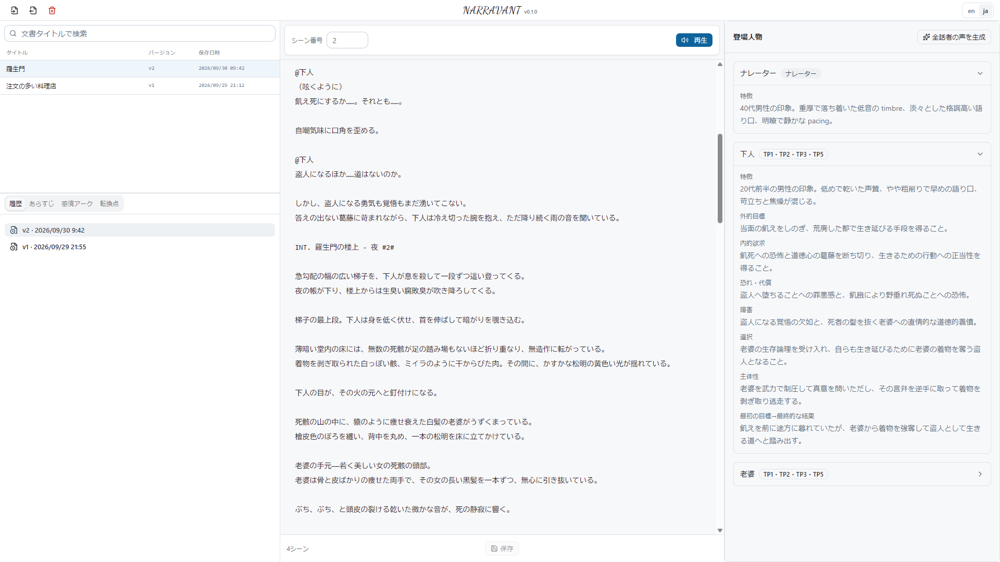
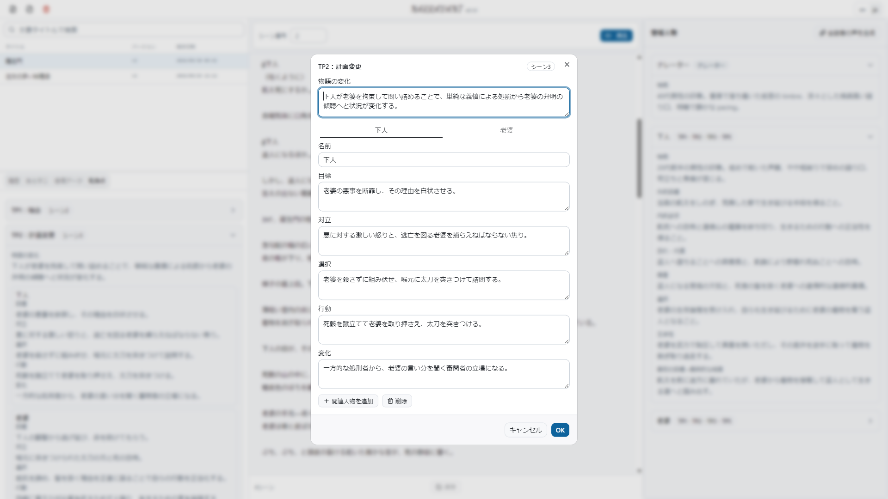

# NARRAVANT

[English](README.md)

現在のバージョン: **0.3.0**。

NARRAVANT は、小説や脚本から、AIで**ナレーション・登場人物の台詞・演技指導を含むオーディオブック用スクリプト**を [Fountain](https://fountain.io/) 形式で生成し、Gemini TTSで朗読する、軽量なローカルアプリケーションです。

**0.3.0**では、小説の**出来事・人物状態・伏線**と原文を参照して場面を計画・執筆します。**Gemini 3.8 Flash TTSのスタイルフィールドとインラインタグに対応する演技指示もAIが自動生成**します。既存の脚本は物語と場面順を保持し、地の文・台詞・演出記法を朗読向けに整えます。

**必要な外部サービスの認証情報は、Gemini APIキー1つだけです。** アプリをセットアップした後は、付属の設定にキーを入れて手元のPCで動かせます。保存にはSQLiteを使い、GPU・ローカルAIモデルのダウンロード・別途のDBサーバーは不要です。Gemini APIの利用料金は別途発生します。

あらすじ・5つの転換点・感情アークの分析にも対応します。BGM・効果音には対応していません。

## スクリーンショット


| 分析ワークベンチ | 5 つの転換点 |
| --- | --- |
|  |  |

### デモ

リアルタイム朗読 — Import・分析・声のデザイン・自動スクロール付き再生:


https://github.com/user-attachments/assets/511a7b1d-07ab-4e1b-8aa5-9045ebe5dd8c

> ここで示すサンプル作品は、著作権が消滅した日本語文学のライブラリ [青空文庫](https://www.aozora.gr.jp/) のものです。

## 主な機能

- **オーディオブック用スクリプト** — 小説または脚本（`.txt` / `.pdf` / `.fountain` / `.fdx`）から、ナレーション・台詞・演技指導を含むFountainを生成します。Native JSONでは作品を復元できます。小説適応は、原文の出来事・人物状態・伏線・関連場面を考慮します。
- **演技指示の自動生成** — 必要な箇所へ演技指導とインラインタグをAIが付けます。持続する演技はGemini 3.8 Flash TTSの `speechMetadata.style` へ、`<short pause>`／`<breath>` などの局所タグはTTSへ渡す本文へ反映します。
- **軽量なローカル構成** — Gemini Developer APIキー1つで生成・声のデザイン・朗読を利用できます。ローカルのPythonサービスとブラウザUIで動き、作品はSQLiteへ保存します。
- **物語の分析** — アップロードした作品から、あらすじ・5 つの転換点・感情アークを生成して保持します。
- **声のデザイン** — ナレーターと各登場人物の声の特徴を生成し、Gemini で声を作成して話者ごとに割り当てます。Geminiに保存したカスタム音声（stateful voice）は最終利用から1年間保持され、TTSで使うたびに保持期間が更新されます（[Google公式ガイド](https://ai.google.dev/gemini-api/docs/generate-content/speech-generation)）。
- **リアルタイム再生** — 各発話を脚本順に Gemini TTS で音声化し、WebSocket でストリーミング再生します。生成音声は保存せず、再生のたびに生成します。
- **ローカル保存** — スクリプト・声の特徴・声の割り当て・分析をローカルのデータベースに保存します。Native JSON で Export・Import できます。
- **日英切替 UI** — 画面表示を英語・日本語で切り替えられます。

## 0.3.0の主な変更

0.3.0には次の変更を含みます。

- 小説の場面計画・執筆へ、対応する原文本文またはPDFページ、出来事、人物の状態・知識、伏線、関連する先行場面を渡します。原作の提示順と因果関係を分けて扱います。
- 初稿の分析後に原文根拠付きで照合し、問題場面を共有上限1回以内で改稿します。本文変更後は分析も更新してから未保存draftを返します。原文と中間計画は文書へ保存しません。
- 地の文は `@ナレーター`／`@Narrator` で記述します。持続する演技をFountainの括弧書きとしてAIが生成し、再生時にGemini 3.8 Flash TTSの `speechMetadata.style` へ反映します。`<short pause>`／`<long pause>`／`<breath>` などのインラインタグも必要な箇所へ自動生成します。
- 文単位のストリーミングとシーン切替の間を保ち、同一シーン内に追加する固定無音を廃止しました。タグは正確なミリ秒やAPI待ちの解消を保証しません。未保存・編集中の本文ではカーソルを含む文から再生できます。
- カスタム声による重なり再生は未対応です。

Native JSON、保存文書、声割当、公開API・イベントのフィールド形状は維持しています。生成音声の老人・子供らしさの品質改善は将来の課題です。

## 技術スタック

- **バックエンド** — Python 3.12+、FastAPI、SQLite（Valence 類似検索に `sqlite-vec` を使用）、Google Gemini（分析・Voice Design・TTS）。
- **フロントエンド** — React 19、TypeScript、Vite、Tailwind CSS、i18next（英語 / 日本語）。
- **ツール** — バックエンドは `uv`、フロントエンドは `npm`、セットアップ・起動・テスト・lint は `make` を使用。

## 前提条件

- **Python 3.12+** と [`uv`](https://docs.astral.sh/uv/)。
- **Node.js 24**（`.nvmrc` を参照）と `npm`。
- **`make`**（以下のセットアップ・起動コマンドで使用）。
- 課金を有効にした **Google Gemini Developer API キー**。

## セットアップと起動手順

### 1. 環境設定（.env）
`.env.example` をコピーして `.env` を作成し、必須の環境変数を設定します。
```bash
cp .env.example .env
```
- `GEMINI_API_KEY`: **必須**。Gemini Developer API の API キーを指定します。
- `GEMINI_MODEL`: 原稿分析・脚色用モデル（既定: `gemini-3.8-flash`）。
- `GEMINI_TTS_MODEL`: 音声合成モデル（既定: `gemini-3.8-flash-tts`）。
- `SQLITE_DB_PATH`: SQLite データベースファイルのパス（既定: `./runtime/narravant.sqlite3`）。相対パスは `.env` があるリポジトリルートから解決されます。
- `LOCAL_STORAGE_PATH`: スクリプト保存ディレクトリ（既定: `./runtime/storage`）。相対パスは `.env` があるリポジトリルートから解決されます。

付属のローカル構成では、他の既定値を保ったまま `GEMINI_API_KEY` のプレースホルダーを自分のキーへ置き換えて起動できます。生成・分析の設定は `backend/config.yaml` にあり、既定では `gemini.thinking_level: MEDIUM` を使用します。設定変更後はbackendを再起動してください。この値はTTSの再生設定ではありません。

> [!WARNING]
> **API 利用料金について**
> Gemini API（原稿分析、Voice Design による声の作成、TTS 音声合成）の呼び出しでは、Google Cloud / Gemini Developer API の料金が発生します。アプリ内に費用の見積もりや残高表示 UI はありませんので、利用状況は Google AI Studio のダッシュボード等でご確認ください。

### 2. 起動手順（2プロセス）
バックエンド（FastAPI: 8000）とフロントエンド（Vite: 5173）をまとめて起動します。

```bash
# 依存関係のセットアップ
make init

# 2 プロセスを起動
make run
```
起動後、ブラウザで `http://localhost:5173` にアクセスします。

各プロセスを個別に起動する場合は `make dev-backend`（FastAPI: 8000）と `make dev-frontend`（Vite: 5173）を使います。

### 3. 基本的な使い方

1. 小説または脚本（`.txt` / `.pdf` / `.fountain` / `.fdx` / Native JSON）を **Import** します。NARRAVANT が Fountain 形式のオーディオブック用スクリプトを生成し、物語を分析します。
2. **分析結果を確認** します（あらすじ・5 つの転換点・感情アーク）。必要に応じて編集・保存します。
3. **声をデザイン** します。ナレーターと各登場人物の声の特徴を記述し、Gemini で声を生成して話者ごとに割り当てます。
4. **再生** します。声が揃えば Save 前でも、画面上の本文と最新の声の割り当てで現在の段落からリアルタイム再生できます。エディタは朗読中のテキストをハイライトし、自動スクロールします。
5. Native JSON で **Export / Import** し、作品をローカルデータベース間で移動できます。

**en / ja** でUIの言語を変更することができます。

## 開発

- `make test` — バックエンド（`pytest`）とフロントエンド（`vitest`）のテストを実行します。
- `make lint` — `ruff`（バックエンド）とフロントエンドの lint を実行します。
- `make clean` — ローカルの仮想環境・`node_modules`・ビルド出力・ローカル DB を削除します。

## プロジェクト構成

```
backend/    FastAPI サービス：API、分析・脚色、Voice Design、TTS、ローカル保存
frontend/   React + Vite の Web クライアント（分析ワークベンチ、再生、日英 UI）
VERSION     リリース番号の正本
```

## バージョニング

本プロジェクトは [セマンティックバージョニング](https://semver.org/lang/ja/) に従います。リリース番号は [`VERSION`](VERSION) に定義し、リリース内容は [`CHANGELOG.md`](CHANGELOG.md) を参照してください。

## 参考文献

NARRAVANT が参照する研究・技術仕様と、その利用箇所・適用の限界は [REFERENCES.md](REFERENCES.md) を参照してください。

## ライセンス

ソフトウェアには [MIT License](LICENSE)（Copyright (c) 2026 Masayuki Irioka）を採用しています。入力した本、第三者の素材、生成音声の利用権はこのライセンスでは付与されません。翻案・配布する作品の権利確認は利用者が行ってください。
